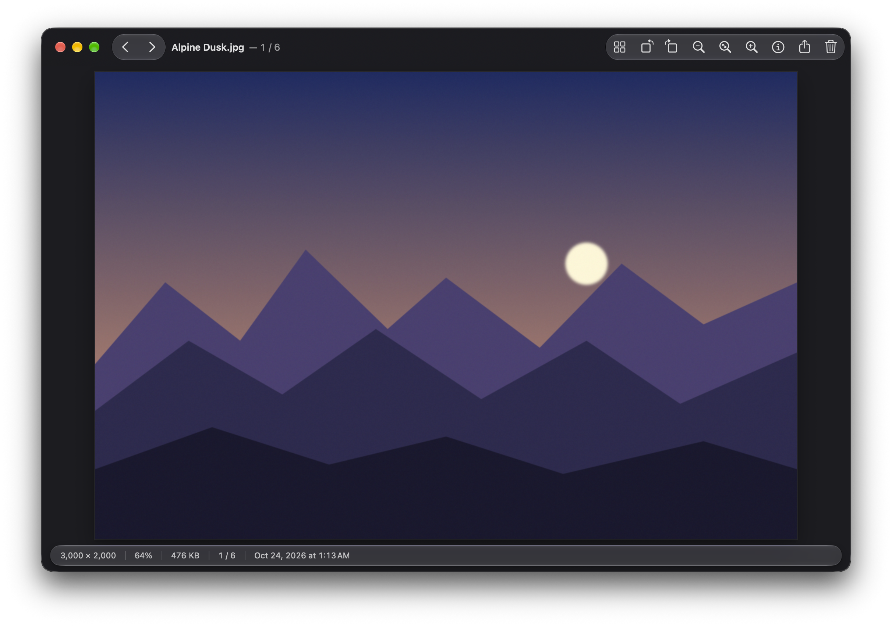
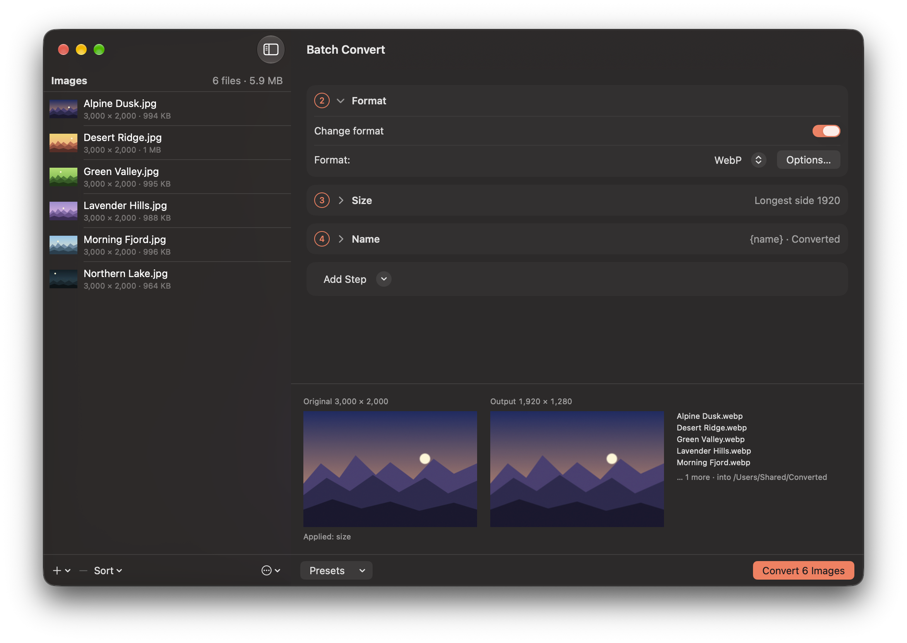

# Featherview

A fast, lightweight, keyboard-driven image viewer for macOS, with batch conversion.

[](https://github.com/featherview/featherview/actions/workflows/ci.yml)
<a href="https://macpip.com/apps/featherview?ref=badge"></a>

Double-click a photo and press <kbd>→</kbd>: Preview stays on that one photo, Featherview goes through
the whole folder.

- **Fast:** first photo on screen in about 0.4 s, the next one in about 20 ms
- **Keyboard first:** turn, trash, move and rename without the mouse
- **Batch:** convert, resize and rename hundreds of photos in one go
- **Free and open source**, for macOS 14 and later; public preview, on the way to 1.0

**[Download](https://github.com/featherview/featherview/releases/latest)** · [Website](https://featherview.mynetx.net) · [Roadmap](ROADMAP.md)

<a href="https://featherview.mynetx.net/#preview"></a>

## Install

With [Homebrew](https://brew.sh):

```sh
brew install --cask featherview/tap/featherview
```

Or by hand:

1. Download the `.dmg` from the [latest release](https://github.com/featherview/featherview/releases/latest)
   and drag Featherview to Applications.
2. Open Terminal and run this once:

   ```sh
   xattr -dr com.apple.quarantine /Applications/Featherview.app
   ```

3. Open Featherview.

Step 2 is needed because Featherview isn't notarized by Apple yet: that costs $99 a year.
[Sponsoring](https://github.com/sponsors/mynetx) helps cover it.

<details>
<summary>More about the first launch</summary>

- The line removes the "downloaded from the internet" mark from Featherview only. The disk image's
  **Read Me First** file has it too, ready to copy.
- On a standard account, macOS asks for an administrator's password when you drag Featherview to
  Applications.
- Administrators can skip Terminal: double-click Featherview, click **Done**, then **Open Anyway** in
  **System Settings → Privacy & Security**. On a standard account this can fail on macOS 26.4 and
  later, so use the Terminal line there.

</details>

## What it does



- **Browse:** whole folders with the arrow keys, then on to the next folder
- **Zoom:** fit, actual size or fill the width, and keep the zoom while you flip
- **Thumbnails:** the whole folder at a glance; select several to move, copy or convert
- **Compare:** two pictures side by side, zoomed in step, with a difference view
- **Slideshow** in full screen or in the window
- **Info panel:** camera settings, histogram and where the photo was taken
- **Photos library:** browse your albums like folders, without exporting
- **Animations and HDR:** GIFs play, iPhone HDR photos shine on HDR screens
- **Huge pictures:** even Hubble's 4.6 GB Andromeda file opens in about two seconds
  ([watch it](https://featherview.mynetx.net/#huge))
- **Lossless turning** of JPEG, HEIC and TIFF
- **Follow New Files:** shows each photo as it arrives, for tethered shooting
- **30 languages**, right to left in Arabic and Hebrew

### Batch convert



- **21 output formats**, among them JPEG, JPEG XL, HEIC, AVIF, WebP and PNG
- **Steps:** resize, crop, rotate, colours, text, watermark, border
- **Rename** by pattern, with a live preview and saved presets

### Keys

| Key | Does |
|---|---|
| <kbd>→</kbd> <kbd>←</kbd> | Next / previous picture |
| <kbd>T</kbd> | Thumbnails |
| <kbd>I</kbd> | Info panel |
| <kbd>F</kbd> or <kbd>Return</kbd> | Full screen |
| <kbd>W</kbd> | Slideshow |
| <kbd>R</kbd> <kbd>L</kbd> | Turn right / left |
| <kbd>H</kbd> <kbd>V</kbd> | Flip horizontally / vertically |
| <kbd>F2</kbd> | Rename |
| <kbd>F7</kbd> <kbd>F8</kbd> | Move / copy to a folder |
| <kbd>⌘⌫</kbd> | Move to Trash |
| <kbd>F5</kbd> | Refresh the folder |
| <kbd>⇧⌘O</kbd> | Open from Photos |

### Formats

- **Everything macOS opens:** JPEG, PNG, HEIC, AVIF, WebP, camera RAW, PSD, SVG, PDF and more
- **16 formats macOS can't:** QOI, PCX, JPEG XR, BPG, Amiga IFF and others
- **Layered files** from Photoshop, GIMP, Krita, Procreate and Paint.NET, shown as one picture
- **Finder thumbnails** and Quick Look previews for the formats only Featherview reads

<details>
<summary>Every format, and what isn't shown</summary>

- Formats macOS can't read: QOI, PCX/DCX, XBM, XPM, WBMP, Sun Raster, IFF/LBM (including HAM),
  MacPaint, PAM, farbfeld, X Window Dump, FITS (astronomy), Windows animated cursors, Kodak Photo CD
  (at 768 × 512), JPEG XR (HD Photo) and BPG
- Layered files, flattened: Photoshop PSB, GIMP XCF, Paint.NET PDN, PaintShop Pro PSP, Krita KRA and
  OpenRaster ORA (their stored flattened image), and Procreate (at full size, turned the way the
  canvas was)
- Photoshop files saved without "Maximize Compatibility" (8-bit RGB) are drawn from their layers:
  every blend mode, groups, layer and vector masks, clipping masks, Blend If, solid colour, gradient
  and pattern fills, and most adjustment layers; text, shape and smart objects show the pixels
  Photoshop stored for them
- Limits: Photoshop layer effects (shadows, glows, strokes) and colour lookups aren't drawn, and
  16-bit, grey or CMYK Photoshop files without a stored composite aren't drawn from their layers;
  in GIMP, Paint.NET and PaintShop Pro files, blend modes other than normal are drawn as normal;
  multichannel PSB and GIMP layer effects aren't shown; `.xcf.gz` isn't read
- Writes: JPEG, JPEG XL, PNG, HEIC, AVIF, TIFF, WebP, GIF, BMP, JPEG 2000, PDF, PSD, TGA, ICO, ICNS,
  OpenEXR, PBM, PGM, PPM, QOI and PCX
- Finder previews: a thumbnail appears after Featherview's first open (switches in System Settings →
  General → Login Items & Extensions → Quick Look)

</details>

## Updates

- Featherview tells you when a new version is out; it never downloads or installs anything by itself.
- About once a day it reads `https://featherview.mynetx.net/appcast.xml`, sending only its version
  number, no cookies.
- Turn it off in Settings › Browsing › "Check for updates automatically".

## Build

Requires Xcode (full install, not only the Command Line Tools).

```sh
scripts/bundle.sh
open build/Featherview.app
```

Disk image: `scripts/dmg.sh` writes `build/Featherview-<version>.dmg`.

## Third-party code

- [libwebp](https://chromium.googlesource.com/webm/libwebp) 1.6.0 (BSD-3-Clause), for writing WebP,
  built from source through [libwebp-Xcode](https://github.com/SDWebImage/libwebp-Xcode).
- [jxrlib](https://github.com/mircomir/jxrlib) 1.4.6 (BSD-2-Clause, Microsoft), for reading JPEG XR,
  vendored in `Sources/CJPEGXR` and built from source by SwiftPM. Thanks to Mirco Miranda, whose
  maintained fork carries years of fixes for damaged files.
- [libjxl](https://github.com/libjxl/libjxl) 0.12.0 (BSD-3-Clause), with
  [highway](https://github.com/google/highway) (Apache-2.0 or BSD-3-Clause),
  [brotli](https://github.com/google/brotli) (MIT) and [skcms](https://skia.googlesource.com/skcms)
  (BSD-3-Clause), for writing JPEG XL, vendored in `Sources/CJPEGXL` and built from source by SwiftPM.
- [Sparkle](https://sparkle-project.org) 2.10.0 (MIT), for automatic updates, from its Swift package
  (a prebuilt framework).
- Place names from [GeoNames](https://www.geonames.org) (CC BY 4.0) and sea, desert and mountain
  outlines from [Natural Earth](https://www.naturalearthdata.com) (public domain), simplified, for the
  info panel. Built per release by `scripts/places.sh` into `places.fvpl`, never committed.

## License

MIT, see [LICENSE](LICENSE).

## Disclaimer

Featherview is an independent, clean-room project inspired by the workflow of classic Windows
image viewers such as IrfanView. It is not affiliated with, endorsed by, or derived from
IrfanView or its author.

Thanks to Irfan Škiljan, whose viewer has shown for decades how fast looking at images can be.
