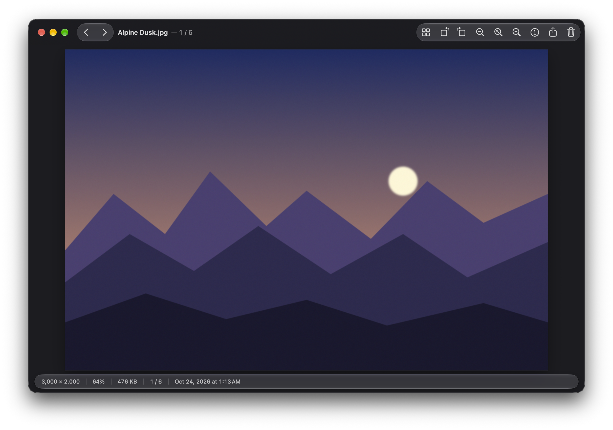
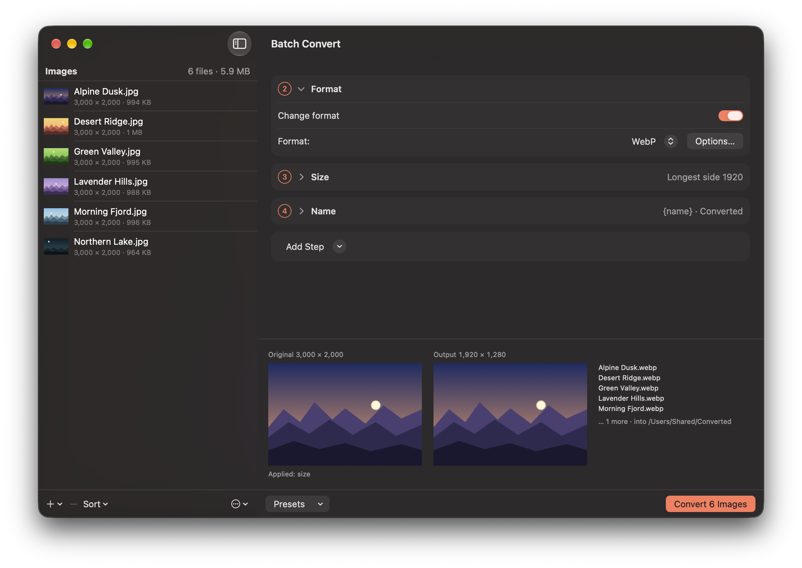

# Featherview

A fast, lightweight, keyboard-driven image viewer for macOS, with batch conversion.

[](https://github.com/featherview/featherview/actions/workflows/ci.yml)

For anyone who flips through folders of photos with the keyboard, the way classic Windows viewers
work: open one image, hold <kbd>→</kbd>, rotate the sideways ones, trash the rejects, batch convert the rest.
About 400 ms from launch to the first image, about 20 ms to the next one (12 MP JPEG, Apple Silicon).

**[Download](https://github.com/featherview/featherview/releases/latest)** · [Website](https://featherview.mynetx.net) · [Roadmap](ROADMAP.md)





## Install

Needs a Mac with Apple Silicon or Intel and macOS 14 (Sonoma) or later.

Download `Featherview-<version>.dmg` from the
[latest release](https://github.com/featherview/featherview/releases/latest), open it and drag `Featherview.app` to
`Applications`.
Or with Homebrew: `brew install --cask featherview/tap/featherview`.

Featherview is free and not notarized by Apple yet, so macOS blocks the first launch. One line in
Terminal lets it open, on any Mac account, administrator or not (the disk image's **Read Me First**
file has it too, ready to copy):

1. Drag Featherview to Applications. On a standard account, macOS asks for an administrator's name
   and password here.
2. Open Terminal, paste this line and press Return. It removes the "downloaded from the internet"
   mark from Featherview only:

   ```sh
   xattr -dr com.apple.quarantine /Applications/Featherview.app
   ```

3. Open Featherview. From now on it opens normally. After this first open, Finder shows thumbnails
   and Quick Look previews for the formats only Featherview reads (switches in System Settings →
   General → Login Items & Extensions → Quick Look).

Administrator? Instead of step 2 you can double-click Featherview, click **Done**, then click
**Open Anyway** in **System Settings → Privacy & Security**. On a standard account Open Anyway can
fail on macOS 26.4 and later (the icon keeps bouncing in the Dock, or the administrator's password is
refused), so use the Terminal line there.

Why the extra step? Featherview is made in our spare time and given away for free. For macOS to open
it straight away, Apple has to notarize it, and that costs $99 every year. If Featherview turns out
useful to you, a [small contribution](https://github.com/sponsors/mynetx) towards that fee would mean
a lot.

## Viewing

- Opens instantly and flips through every image in the folder with the arrow keys; past the last
  one, a keyboard-driven folder chooser takes you on to the next folder
- Fit, actual size, zoom to width or height for tall and wide images, and Keep Zoom to look at the
  same spot from image to image
- Thumbnail grid (<kbd>T</kbd>) of the folder, with a size slider and selection: Quick Look, move, copy, Trash
  and batch convert several images at once
- Slideshow (<kbd>W</kbd>) in full screen or in the window (<kbd>⇧A</kbd>), with shuffle and repeat; <kbd>Space</kbd> pauses
- Compare two images side by side, zoomed and panned in step, with a difference view
- Plays animated GIF, PNG, WebP, HEIC and AVIF, and Windows animated cursors; <kbd>G</kbd> pauses, <kbd>⌥→</kbd> / <kbd>⌥←</kbd> step
  frames
- HDR photos (iPhone HEIC and JPEG, HDR AVIF, OpenEXR) show their extra brightness on HDR screens
  (macOS 15 and later)
- EXIF info panel (<kbd>I</kbd>), full screen (<kbd>F</kbd> or <kbd>Return</kbd>)

## Organising

- Move and copy to folders with <kbd>F7</kbd> / <kbd>F8</kbd> (14 destinations, one key each), Move to Trash with <kbd>⌘⌫</kbd>;
  sidecar files (`.xmp`, `.aae`, `.thm`) go along
- Rename (<kbd>F2</kbd>), and sort by name, date modified, date taken, size or kind
- Lossless rotate and flip of JPEG, HEIC and TIFF (<kbd>R</kbd> <kbd>L</kbd> <kbd>H</kbd> <kbd>V</kbd>); adjust the date taken in place
- Follow New Files shows each image as it lands in the folder, for tethered shooting and screenshots
- Open Recent, Share, Set as Desktop Picture (fill, fit, stretch or centre), Float on Top, New from Clipboard (<kbd>⌘N</kbd>)
- Refresh the folder (<kbd>F5</kbd>), jump to a random image

## Formats

- Opens everything macOS can read (JPEG, PNG, HEIC, AVIF, JPEG XL, WebP, TIFF, GIF, PSD, camera RAW
  and more), upright and colour-managed, plus SVG and PDF pages
- Also reads 16 formats macOS can't, such as QOI, PCX, XPM, IFF/LBM, JPEG XR and BPG, and shows
  layered files from GIMP, Krita, Paint.NET, Procreate and others flattened
- Finder thumbnails and Quick Look (<kbd>Space</kbd>) previews for all of them

<details>
<summary>Every extra format, and what isn't shown</summary>

- Formats macOS can't read: QOI, PCX/DCX, XBM, XPM, WBMP, Sun Raster, IFF/LBM (including HAM),
  MacPaint, PAM, farbfeld, X Window Dump, FITS (astronomy), Windows animated cursors, Kodak Photo CD
  (at 768 × 512), JPEG XR (HD Photo) and BPG
- Layered files, flattened: Photoshop PSB, GIMP XCF, Paint.NET PDN, PaintShop Pro PSP, Krita KRA and
  OpenRaster ORA (their stored flattened image), and Procreate (at full size, turned the way the
  canvas was)
- Limits: blend modes other than normal are drawn as normal; PSB files without a stored composite,
  multichannel PSB and GIMP layer effects aren't shown; `.xcf.gz` isn't read

</details>

## Converting

- Saves and batch converts to JPEG, JPEG XL, PNG, HEIC, AVIF, TIFF, WebP, GIF, BMP, JPEG 2000, PDF,
  PSD, TGA, ICO, ICNS, OpenEXR, PBM, PGM, PPM, QOI and PCX
- Batch convert and rename with crop, resize, rotate, colour, filters, canvas, border, text and
  watermark steps, a live preview and presets
- The batch can also write every frame or page of a file as its own image, cut each image into
  tiles, and set or shift the date taken

In 30 languages, with right-to-left layout in Arabic and Hebrew. Public preview, on the way to 1.0.

## Updates

About once a day Featherview reads a small feed at `https://featherview.mynetx.net/appcast.xml` (no
cookies; the request carries only the app's version) and tells you when a new version is out; it never downloads
or installs anything itself. Turn it off in Settings › Browsing › "Check for updates automatically".

## Build

Requires Xcode (full install, not only the Command Line Tools).

```sh
scripts/bundle.sh
open build/Featherview.app
```

Disk image: `scripts/dmg.sh` writes `build/Featherview-<version>.dmg`.

## Third-party code

- [libwebp](https://chromium.googlesource.com/webm/libwebp) 1.6.0 (BSD-3-Clause), for writing WebP,
  built from source through [libwebp-Xcode](https://github.com/SDWebImage/libwebp-Xcode).
- [jxrlib](https://github.com/mircomir/jxrlib) 1.4.4 (BSD-2-Clause, Microsoft), for reading JPEG XR,
  vendored in `Sources/CJPEGXR` and built from source by SwiftPM. Thanks to Mirco Miranda, whose
  maintained fork carries years of fixes for damaged files.
- [libjxl](https://github.com/libjxl/libjxl) 0.12.0 (BSD-3-Clause), with
  [highway](https://github.com/google/highway) (Apache-2.0 or BSD-3-Clause),
  [brotli](https://github.com/google/brotli) (MIT) and [skcms](https://skia.googlesource.com/skcms)
  (BSD-3-Clause), for writing JPEG XL, vendored in `Sources/CJPEGXL` and built from source by SwiftPM.
- [Sparkle](https://sparkle-project.org) 2.10.0 (MIT), for automatic updates, from its Swift package
  (a prebuilt framework).
- Place names from [GeoNames](https://www.geonames.org) (CC BY 4.0) and sea, desert and mountain
  outlines from [Natural Earth](https://www.naturalearthdata.com) (public domain), simplified, for the
  info panel. Built per release by `scripts/places.sh` into `places.fvpl`, never committed.

## License

MIT, see [LICENSE](LICENSE).

## Disclaimer

Featherview is an independent, clean-room project inspired by the workflow of classic Windows
image viewers such as IrfanView. It is not affiliated with, endorsed by, or derived from
IrfanView or its author.

Thanks to Irfan Škiljan, whose viewer has shown for decades how fast looking at images can be.
